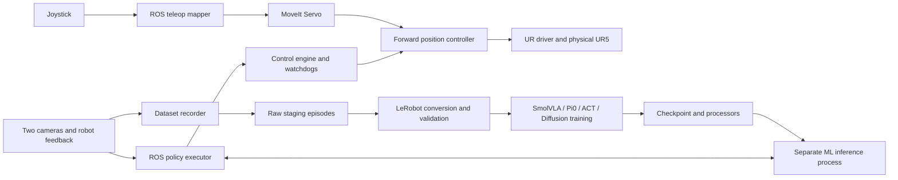

# UR5 VLA complete guide

A practical guide and source snapshot for connecting a physical UR5, using joystick teleoperation, recording demonstrations, converting them to LeRobot, training policies, and running supervised experiments. The starting installation uses Ubuntu 22.04, ROS 2 Humble, a CB3 UR5, two RealSense cameras, and a Robotiq electric gripper controlled through the installation's binary UR IO interface.

The commands below use **this repository's workspaces**. You do not need the previous project's workspace. Change installation-specific IP addresses, camera serials, gripper wiring, robot calibration, and taught poses before using another robot.

This repository contains application code and the lab's LeRobot source snapshot. Datasets, model weights, machine credentials, recorded results, and the lab's pose calibration files are separate artifacts. Clone the repository, record or obtain a dataset, and train or install a checkpoint as described below.

## Contents

1. [System architecture and supported workflows](#1-system-architecture-and-supported-workflows)
2. [Computer, hardware, and software requirements](#2-computer-hardware-and-software-requirements)
3. [Clone, paths, and terminal environments](#3-clone-paths-and-terminal-environments)
4. [UR5 physical arm installation](#4-ur5-physical-arm-installation)
5. [Driver, MoveIt, controllers, and Servo](#5-driver-moveit-controllers-and-servo)
6. [Two RealSense camera feeds](#6-two-realsense-camera-feeds)
7. [Joystick teleoperation and gripper](#7-joystick-teleoperation-and-gripper)
8. [Standard pose and switching control modes](#8-standard-pose-and-switching-control-modes)
9. [Record and save raw demonstration episodes](#9-record-and-save-raw-demonstration-episodes)
10. [Experiment 2: sort the fruits](#10-experiment-2-sort-the-fruits)
11. [Review episodes and keep a clean dataset](#11-review-episodes-and-keep-a-clean-dataset)
12. [Install the machine learning environment](#12-install-the-machine-learning-environment)
13. [Convert raw episodes to LeRobot](#13-convert-raw-episodes-to-lerobot)
14. [Validate, package, and transfer a dataset](#14-validate-package-and-transfer-a-dataset)
15. [UR5 observation and action configuration](#15-ur5-observation-and-action-configuration)
16. [Train SmolVLA](#16-train-smolvla)
17. [Train Pi0](#17-train-pi0)
18. [Train ACT and Diffusion baselines](#18-train-act-and-diffusion-baselines)
19. [W&B charts, progress, and checkpoint recovery](#19-wb-charts-progress-and-checkpoint-recovery)
20. [Train on another machine or Google Colab](#20-train-on-another-machine-or-google-colab)
21. [Offline validation and live shadow inference](#21-offline-validation-and-live-shadow-inference)
22. [Physical policy execution: commands and order](#22-physical-policy-execution-commands-and-order)
23. [Optional offsets, bowl release, and planned placement](#23-optional-offsets-bowl-release-and-planned-placement)
24. [Record evaluation telemetry and both camera feeds](#24-record-evaluation-telemetry-and-both-camera-feeds)
25. [Troubleshooting](#25-troubleshooting)
26. [Shutdown](#26-shutdown)
27. [Repository and data tree](#27-repository-and-data-tree)
28. [Source references and verification scope](#28-source-references-and-verification-scope)

## 1. System architecture and supported workflows



Teleoperation and policy execution are separate operating modes. During teleoperation, Servo owns arm output. During policy execution, the standalone control engine owns arm output and Servo is stopped. Keep one active arm command source.

| Component | Purpose | Status in this guide |
|---|---|---|
| ROS recorder and converter | Synchronized UR5 demonstrations and LeRobot datasets | Included application code |
| SmolVLA | Language-conditioned image/state-to-action policy | Based on the existing physical deployment workflow; newly trained checkpoints still require qualification |
| Pi0 | Larger language-conditioned policy | Training and generic loading recipes included; no claim of physical validation for a new Pi0 checkpoint |
| ACT | Task-specific behavior cloning baseline | Training recipe; language instructions do not make the default ACT policy language-conditioned |
| Diffusion | Task-specific diffusion baseline | Training recipe; temporal observation adaptation is needed before using the current live bridge |
| Planned bowl transport | MoveIt route after the policy requests a stable close | Optional assisted completion; this is a different evaluation condition from a fully policy-generated route |

The ML process has no ROS command publishers. Its output passes through the ROS executor and control engine. A valid dataset, low training loss, or a loaded checkpoint does not by itself establish correct physical behavior.

## 2. Computer, hardware, and software requirements

| Item | Installation expectation |
|---|---|
| OS | Ubuntu 22.04 for the ROS host |
| ROS | ROS 2 Humble, sourced in each ROS terminal |
| Robot | UR5 CB3 in the original setup; select the correct driver model for your actual arm |
| Robot link | Dedicated wired Ethernet with the robot and PC on the same subnet |
| Cameras | Two RealSense RGB-D cameras, stable USB 3 connections, 640×480 color and aligned depth |
| Joystick | Logitech layout described below; verify button indexes on your actual device |
| Gripper | Robotiq electric gripper, using the already configured binary IO interface in this installation |
| ROS Python | `/usr/bin/python3`, normally Python 3.10 on Ubuntu 22.04 |
| ML Python | Python 3.12 for the bundled LeRobot snapshot |
| Training GPU | CUDA-capable NVIDIA GPU; Pi0 needs substantially more memory than SmolVLA |
| Disk | Recorder requires 20 GiB free; the custom Pi0 checkpoint writer requires 50 GiB reserve |

Keep ROS and ML environments separate. Installing a recent NumPy or ML stack into the system Python can break ROS binary extensions. The inference socket is the boundary between the two environments.

Install ROS 2 Humble using the [official Ubuntu installation instructions](https://docs.ros.org/en/humble/Installation/Ubuntu-Install-Debs.html). Then install the application dependencies:

```bash
sudo apt update
sudo apt install -y \
  ros-humble-ur ros-humble-moveit ros-humble-moveit-servo \
  ros-humble-joy ros-humble-realsense2-camera ros-humble-rqt-image-view \
  ros-humble-cv-bridge ros-humble-ur-msgs ros-humble-ur-dashboard-msgs \
  ros-humble-controller-manager-msgs ros-humble-control-msgs \
  ros-humble-moveit-msgs ros-humble-trajectory-msgs \
  python3-colcon-common-extensions python3-rosdep \
  python3-opencv python3-numpy python3-yaml python3-pytest \
  python3-pil git ffmpeg net-tools
```

Record the machine's installed versions when reproducing an experiment:

```bash
uname -a
lsb_release -a
/usr/bin/python3 --version
ros2 doctor --report
nvidia-smi
```

## 3. Clone, paths, and terminal environments

### 3.1 Clone the new repository

```bash
mkdir -p "$HOME/projects"
cd "$HOME/projects"
git clone https://github.com/shafakatmasud/Ur5-vla-complete-guide.git
cd Ur5-vla-complete-guide
cp .env.example .env
```

Edit `.env` for your robot Ethernet interface, IP addresses, and two camera serial numbers. The example addresses describe the original lab network; they are not automatic network configuration.

```bash
nano .env
source scripts/env.sh
printf 'Repository: %s\nML Python: %s\n' "$UR5_VLA_ROOT" "$VLA_PYTHON"
```

`export` and `source` normally print nothing on success. They configure the current terminal; they do not start the robot. Open a fresh terminal and source the helper there too:

```bash
source "$HOME/projects/Ur5-vla-complete-guide/scripts/env.sh"
```

All later commands assume this step. If you cloned elsewhere, use its actual path. `scripts/env.sh` finds this repository automatically and optionally loads its hardware overlay and application overlay. It also defines the ML cache directories and Python import path.

### 3.2 Create the data layout

```bash
mkdir -p \
  "$UR5_VLA_ROOT/data/dataset/staging/episodes" \
  "$UR5_VLA_ROOT/data/dataset/quarantine" \
  "$UR5_VLA_ROOT/data/dataset/lerobot" \
  "$UR5_VLA_ROOT/data/models/checkpoints" \
  "$UR5_VLA_ROOT/data/models/evaluation" \
  "$UR5_VLA_ROOT/data/calibration"
```

`data/dataset/` has three categories: `staging`, `quarantine`, and `lerobot`. Training outputs live under `data/models/checkpoints/`; validation and evaluation outputs live under `data/models/evaluation/`.

### 3.3 Build the application workspace

Use a clean ROS terminal with the system Python, without an activated Conda environment:

```bash
source /opt/ros/humble/setup.bash
cd "$UR5_VLA_ROOT/ros2_ws"
# Run sudo rosdep init only on a machine where rosdep has never been initialized.
rosdep update
rosdep install --from-paths src --ignore-src -r -y
colcon build --symlink-install --packages-select ur5_vla_dataset_recorder
source install/local_setup.bash
ros2 pkg executables ur5_vla_dataset_recorder
```

The expected entry points include `dataset_recorder`, `logitech_servo`, `prepare_dataset_start`, `convert_lerobot`, `validate_lerobot`, and `policy_executor`. The last one is the **shadow monitor**; physical execution is described in Chapter 22.

The `hardware_ws/` directory is reserved for optional site-specific drivers. The current UR IO gripper workflow uses the apt-installed UR driver and does not require a second workspace build. A serial-controlled Robotiq driver is a different integration: configure its hardware plugin, port, action interface, and feedback adapter before expecting these binary IO commands to operate it.

## 4. UR5 physical arm installation

### 4.1 Mechanical setup and robot installation

Mount the arm and table securely. Configure the actual tool center point, payload, and center of gravity in the robot installation. Include the gripper, mounting plate, wrist camera, and cables in the installation assessment. A mismatched payload or an obstructed route can cause protective stops even when ROS networking works.

Keep the robot's physical protective functions active. Clear a protective stop on the pendant only after inspecting its cause. Do not use repeated software reset as a substitute for resolving an unexpected startup jump or collision.

### 4.2 Configure the Ethernet link

The original installation used:

| Endpoint | Example |
|---|---|
| Robot | `10.0.1.38` |
| PC robot-facing NIC | `10.0.1.42/24` |
| Robot-facing interface | `enp179s0f1` |
| External Control remote host | PC address, port `50002` |

Inspect your actual network first:

```bash
ip -br address
ip route get "$ROBOT_IP"
nmcli device status
ping -c 4 "$ROBOT_IP"
```

For a **dedicated robot NIC that you have identified**, this temporary command adds the PC address until network configuration changes or the machine reboots:

```bash
sudo ip address add "$PC_IP/24" dev "$ROBOT_INTERFACE"
sudo ip link set "$ROBOT_INTERFACE" up
ip route get "$ROBOT_IP"
```

Skip `ip address add` if the address is already assigned. For persistent configuration, use Ubuntu's wired network settings or the appropriate NetworkManager connection profile. Do not assign the robot's own IP to the PC. Avoid adding a default gateway on the robot-only link; keep internet access on the appropriate network interface.

Check that a Wi-Fi change has not changed the robot route or PC address. The robot connects back to the PC for External Control, so successful PC-to-robot ping alone is insufficient.

### 4.3 Install and configure External Control

Follow the UR driver's [robot setup instructions](https://github.com/UniversalRobots/Universal_Robots_ROS2_Driver/blob/humble/ur_robot_driver/doc/installation/robot_setup.rst) for the robot's supported PolyScope version and the External Control URCap.

On the pendant:

1. Install the compatible External Control URCap and restart when required.
2. Set the External Control host to the PC's robot-facing address, for example `10.0.1.42`.
3. Set its port to `50002` unless you explicitly change the driver configuration too.
4. Insert an External Control node into the robot program and save the installation/program.
5. Verify TCP and payload settings, release the emergency stop when the workspace is ready, and bring the robot to its normal operating state.
6. Start the ROS driver before pressing Play on the External Control program.

The CB3 UR5 pendant differs from an e-Series pendant. Use the matching driver documentation; do not assume an e-Series remote-control menu exists on a CB3 installation.

### 4.4 Extract the robot's factory kinematic calibration

Do this once per physical arm and store the result outside Git:

```bash
ros2 launch ur_calibration calibration_correction.launch.py \
  robot_ip:="$ROBOT_IP" \
  target_filename:="$UR5_VLA_ROOT/data/calibration/ur5_kinematics.yaml"
```

Set the following in `.env` after the extraction succeeds:

```bash
UR_KINEMATICS_FILE=/absolute/path/to/Ur5-vla-complete-guide/data/calibration/ur5_kinematics.yaml
```

Re-source `scripts/env.sh` afterwards. This is the arm's factory calibration. It is separate from a camera-to-robot calibration or a taught bowl location.

## 5. Driver, MoveIt, controllers, and Servo

Use separate terminals for long-running processes. Source `scripts/env.sh` in each.

### 5.1 Terminal A: UR driver

```bash
driver_args=(
  ur_type:=ur5
  robot_ip:="$ROBOT_IP"
  reverse_ip:="$PC_IP"
  launch_rviz:=false
  initial_joint_controller:=forward_position_controller
  activate_joint_controller:=false
)
if [[ -n "${UR_KINEMATICS_FILE:-}" ]]; then
  driver_args+=(kinematics_params_file:="$UR_KINEMATICS_FILE")
fi
ros2 launch ur_robot_driver ur_control.launch.py "${driver_args[@]}"
```

Leave the terminal running. On the pendant, play the External Control program. If it reports a refusal at `PC_IP:50002`, check that the driver is actually listening:

```bash
ss -ltnp 'sport = :50002'
ros2 topic echo /io_and_status_controller/robot_program_running --once
ros2 control list_controllers
```

### 5.2 Terminal B: MoveIt and Servo

```bash
moveit_args=(ur_type:=ur5 launch_rviz:=true launch_servo:=true)
if [[ -n "${UR_KINEMATICS_FILE:-}" ]]; then
  moveit_args+=(kinematics_params_file:="$UR_KINEMATICS_FILE")
fi
ros2 launch ur5_vla_dataset_recorder ur5_moveit.launch.py "${moveit_args[@]}"
```

The included launch is adapted from the installed UR MoveIt launch to expose the same factory calibration YAML used by the driver; it does not modify `/opt/ros`. Use the same robot description/calibration configuration as the driver. Inspect the planning scene in RViz and add the actual table, bowl, and fixtures using the site's scene configuration. An empty planning scene cannot check collisions against an unregistered bowl or table.

### 5.3 Activate the expected controller

The application publishes six joint positions to `/forward_position_controller/commands`:

```bash
ros2 control list_controllers
ros2 control switch_controllers \
  --activate forward_position_controller \
  --deactivate scaled_joint_trajectory_controller \
  --strict
ros2 control list_controllers
```

Use this switch when the scaled trajectory controller is active. If it is already inactive, activate only `forward_position_controller`. The `--strict` switch should not be expected to deactivate a nonexistent controller. Never keep two incompatible arm controllers active.

### 5.4 Set and confirm the robot speed

The tests underlying this application used a robot speed slider at **20% or below**, in addition to application speed scaling:

```bash
ros2 service call /io_and_status_controller/set_speed_slider \
  ur_msgs/srv/SetSpeedSliderFraction '{speed_slider_fraction: 0.2}'
ros2 topic echo /speed_scaling_state_broadcaster/speed_scaling --once
```

The service uses a fraction (`0.2`); the broadcaster commonly displays a percentage (`20.0`). The policy's `--speed-scale 0.5` is another application-level setting and does not set the robot slider.

### 5.5 Confirm live feedback and planning services

```bash
ros2 topic hz /joint_states
ros2 topic echo /servo_node/status --once
ros2 service list | rg 'compute_fk|compute_ik|check_state_validity|plan_kinematic_path|start_servo|stop_servo'
ros2 service call /dashboard_client/program_running ur_dashboard_msgs/srv/IsProgramRunning '{}'
ros2 service call /dashboard_client/get_safety_mode ur_dashboard_msgs/srv/GetSafetyMode '{}'
```

Start Servo when entering teleoperation:

```bash
ros2 service call /servo_node/start_servo std_srvs/srv/Trigger '{}'
```

Stop it before standalone policy execution:

```bash
ros2 service call /servo_node/stop_servo std_srvs/srv/Trigger '{}'
```

## 6. Two RealSense camera feeds

Identify the serial numbers with `rs-enumerate-devices` if the RealSense tools are installed, or inspect the camera driver's discovery output. Put the real serials into `.env`. The leading underscore in the launch serial argument helps preserve a numeric serial as a string.

### 6.1 Terminal C: base camera

```bash
ros2 launch realsense2_camera rs_launch.py \
  serial_no:="_$BASE_CAMERA_SERIAL" \
  camera_namespace:=base camera_name:=camera \
  initial_reset:=true enable_color:=true enable_depth:=true \
  align_depth.enable:=true \
  rgb_camera.color_profile:=640x480x30 \
  depth_module.depth_profile:=640x480x30
```

### 6.2 Terminal D: wrist camera

```bash
ros2 launch realsense2_camera rs_launch.py \
  serial_no:="_$WRIST_CAMERA_SERIAL" \
  camera_namespace:=wrist camera_name:=camera \
  initial_reset:=true enable_color:=true enable_depth:=true \
  align_depth.enable:=true \
  rgb_camera.color_profile:=640x480x30 \
  depth_module.depth_profile:=640x480x30
```

### 6.3 Check and view both feeds

```bash
ros2 topic hz /base/camera/color/image_raw
ros2 topic hz /wrist/camera/color/image_raw
ros2 topic hz /base/camera/aligned_depth_to_color/image_raw
ros2 topic hz /wrist/camera/aligned_depth_to_color/image_raw
ros2 run rqt_image_view rqt_image_view
```

In two Image View windows, select `/base/camera/color/image_raw` and `/wrist/camera/color/image_raw`. Keep camera placement, resolution, and image orientation consistent between demonstrations and deployment. The existing model is sensitive to a changed camera view.

The cameras run at 30 FPS while the recorder samples at 20 Hz. A visible rqt image can still be stale; inspect topic rate and recorder diagnostics if recording is rejected.

## 7. Joystick teleoperation and gripper

### 7.1 Terminal E: joystick input

```bash
ros2 run joy joy_enumerate_devices
ros2 run joy joy_node --ros-args \
  -p device_id:=0 -p deadzone:=0.1 -p autorepeat_rate:=50.0
```

Change `device_id` to the device returned by enumeration. Inspect its input in another terminal:

```bash
ros2 topic echo /joy
```

Press and release individual buttons to verify the array indexes. Physical button labels are one-based; `sensor_msgs/Joy.buttons` indexes are zero-based.

### 7.2 Terminal F: mapper

First prepare the robot as described in Chapter 8. Then:

```bash
ros2 run ur5_vla_dataset_recorder logitech_servo
```

| Control | Function in the included mapper |
|---|---|
| Trigger / physical button 1 | Deadman: hold for arm motion |
| Stick X/Y with trigger | Translation in the configured base frame |
| Stick twist with trigger | Rotation about the configured axis |
| Button 5 / 6 with trigger | Down / up |
| Button 2 | Close gripper |
| Button 3 | Open gripper |
| Button 7 held about 2 seconds, trigger released | Guarded standard-pose request |
| Button 9 | Start recording, if a recorder is running |
| Button 10 | Abort/discard recording |
| Button 11 | Save successful recording |

The recorder handles buttons 9–11 independently; the mapper handles arm/gripper commands. One `joy_node` supplies both. Avoid duplicate joystick input nodes or duplicate mappers.

### 7.3 Gripper semantics and checks

The application convention is **0 = closed, 1 = open**. The original installation maps these to two UR digital outputs through `/io_and_status_controller/set_io`. This is an installation-specific interface for the electric gripper, not a generic Robotiq force/position driver.

```bash
ros2 service type /io_and_status_controller/set_io
ros2 topic echo /gripper/state --once
ros2 topic echo /io_and_status_controller/io_states --once
```

With teleop active and the arm stationary, test button 3 and then button 2 while observing the fingers. A successful SetIO reply confirms the IO write, not contact with an object or grasp force. Set payload and the gripper's own force configuration through its supported installation interface; this repository does not change force registers.

During physical policy execution, stop the mapper and let the control engine manage the gripper. Running a joystick mapper simultaneously can overwrite policy IO intent. Joystick gripper override requires a designed arbitration mode; it is not part of this default workflow.

## 8. Standard pose and switching control modes

The standard joint pose is installation-specific. Review `standard_pose_node.py` and the route in RViz before using it in another installation. A command that succeeded in the original lab is not evidence that its route clears another table or tool.

### 8.1 Prepare for recording

With the workspace clear, no policy executor/control engine running, and no held object:

```bash
ros2 run ur5_vla_dataset_recorder prepare_dataset_start
```

Wait for `DATASET START READY`. This guarded helper prepares the start pose and restores the Servo state needed by recording. Then start the joystick mapper. During teleop, button 7 provides the mapper's standard-pose handover.

The separate guarded pose command is:

```bash
ros2 run ur5_vla_dataset_recorder move_to_standard_pose
```

`scripts/standard_pose.py` is also included for compatibility with the older standalone workflow. Prefer the guarded ROS package helper for the documented setup.

### 8.2 Change from teleop to policy

1. Finish or discard the current recording.
2. Release the joystick trigger and stop the mapper with Ctrl+C.
3. Return to the established start pose while the appropriate guarded teleop path is available.
4. Stop Servo before starting the standalone control engine.
5. Run the policy commands in Chapter 22.

### 8.3 Change from policy to teleop

Stop the policy executor first. Inspect any fault, then stop the engine. Restore Servo and start the mapper. Do not use standard-pose motion to pull the arm out of a collision or while holding an object you intend to preserve.

The `--prepare-episode` option used later **opens the gripper and prepares software episode state**. It does not move the arm to standard pose. Treat it as a physical gripper action and ensure no object is held.

## 9. Record and save raw demonstration episodes

### 9.1 Terminal G: recorder

With both cameras, robot feedback, joystick input, Servo, and mapper ready:

```bash
ros2 launch ur5_vla_dataset_recorder recorder.launch.py
```

Set the instruction before starting an episode:

```bash
ros2 param set /dataset_recorder task \
  'Pick up the orange cube and place it in the bowl'
```

The default recorder configuration resolves data relative to this repository and writes below `data/dataset/staging/episodes/`.

### 9.2 Record one episode

1. Place the object and bowl in the intended scene and open the gripper.
2. Press **9** once. Wait for the recorder's start confirmation.
3. Use the joystick to complete the entire task.
4. After the object is released into the bowl, press **11** once.
5. Wait for the save confirmation and a finalized `episode_...` directory before starting another.
6. If the demonstration is unsuitable, press **10** to abort/discard it.

Services provide the same recording controls without relying on a joystick mapping:

```bash
ros2 service call /dataset_recorder/start_episode std_srvs/srv/Trigger '{}'
ros2 service call /dataset_recorder/save_success std_srvs/srv/Trigger '{}'
ros2 service call /dataset_recorder/discard_episode std_srvs/srv/Trigger '{}'
ros2 service call /dataset_recorder/status std_srvs/srv/Trigger '{}'
```

`stop_episode` stops recording for subsequent labeling; `save_failure` records a failed outcome. Successful training selection should use reviewed successful demonstrations rather than silently treating failed episodes as success.

### 9.3 How to know whether it saved

An active episode uses a hidden directory such as `.episode_YYYYMMDD_HHMMSS.incomplete`. This is the writer's transaction directory. It remains incomplete until file writing, metadata finalization, and the final directory rename succeed.

```bash
ros2 service call /dataset_recorder/status std_srvs/srv/Trigger '{}'
ls -la "$UR5_VLA_ROOT/data/dataset/staging/episodes"
```

A normal finalized episode is named `episode_...` and contains `metadata.yaml`, `frames.jsonl`, and its camera/depth files. Do not rename `.incomplete` manually to make it look saved. If it remains after an error, preserve it for inspection, check recorder logs, disk space, writer errors, and whether button 11 actually arrives in `/joy`.

### 9.4 What is recorded

The raw recorder stores synchronized samples with joint state, commanded arm target, gripper command/state estimate, color views, aligned depth, sample timestamps, and source freshness/Servo checks. The exact frame schema is implemented in `core.py`, `recorder_node.py`, and `episode_writer.py`.

Default settings include 20 Hz recording, 640×480 color, JPEG quality 90, 0.10 s freshness limits for required inputs, a bounded writer queue, and a 20 GiB minimum free-space check. Depth uses RealSense `16UC1` units converted with `0.001` metres per unit. Missing or stale data can prevent start or interrupt an episode.

The recorder observes the robot; it does not command its motion. Additional process diagnostics and evaluation videos come from the telemetry monitor described later.

## 10. Experiment 2: sort the fruits

Use two apples and two cubes in the workspace. The instruction is **“Sort the fruits”**. One successful demonstration picks each apple, one after another, and places both in the bowl while leaving both cubes outside.

Start the driver, MoveIt/Servo, cameras, and one `joy_node` as above. Stop any existing mapper, recorder, standalone engine, or policy executor before launching the experiment wrapper:

```bash
bash "$UR5_VLA_ROOT/scripts/record_experiment2_sort_fruits.sh"
```

This launches the mapper, the experiment-specific recorder, and the read-only demonstration telemetry monitor. Buttons remain **9 start, 10 abort, 11 success**. Save only after both apples are placed.

The output paths are:

```text
data/dataset/staging/experiment_2_sort_fruits/
├── episodes/       raw demonstrations
├── setup/          setup/ROS logs
└── telemetry/      per-episode monitoring artifacts
```

Prefer a continuous demonstration: after placing the first apple, move from that pose to the second apple. A standard-pose reset between apples adds a reset behavior the policy may learn and creates a different task sequence. Use a reset between complete episodes when needed.

Vary apple locations, order, distractor locations, and reasonable object orientations while keeping the task instruction consistent. Include recovery behavior only when it is a behavior you actually want the trained policy to reproduce. Keep failed demonstrations separate and record the reason for rejection.

The helper's `--prepare-only` option starts the recording stack without enabling Servo. It does not make the arm ready for motion; restore the physical robot state and deliberately enable the normal workflow afterwards.

## 11. Review episodes and keep a clean dataset

`staging` holds new recordings, `quarantine` holds rejected or interrupted material retained for diagnosis, and `lerobot` holds immutable conversion outputs with distinct names.

Review both camera views and the task outcome. Check image/depth completeness, joint order, plausible trajectories, gripper transitions, and whether the intended object actually reached the bowl. Do not use gripper IO alone as a success label.

Make a reviewed episode list in an ignored data file, one directory name per line:

```bash
nano "$UR5_VLA_ROOT/data/dataset/staging/reviewed_episodes.txt"
```

Example contents, replaced with your real folder names:

```text
episode_YYYYMMDD_HHMMSS
episode_YYYYMMDD_HHMMSS
```

Use different real names on each line. Record excluded episode names and reasons in your experiment records. Move a rejected episode only when it is finalized and no recorder is using it:

```bash
# Example only: substitute a real finalized rejected episode.
mv "$UR5_VLA_ROOT/data/dataset/staging/episodes/episode_REJECTED" \
   "$UR5_VLA_ROOT/data/dataset/quarantine/"
```

Split training and validation by **whole episode**, preferably also by object location or recording session. Adjacent frames from one demonstration are highly correlated and should not be presented as independent held-out evidence.

## 12. Install the machine learning environment

The bundled LeRobot source reports version **0.5.2** and requires Python **3.12 or newer**. The lab snapshot is included because a version string alone does not reconstruct its source. `config/source_provenance.json` records the snapshot and source hashes; the exact upstream LeRobot commit could not be recovered from the flattened local copy.

The old name `pi0` referred to a Conda environment, not a conversion format or the selected policy. This guide uses a path-based environment and `VLA_PYTHON` to make that distinction explicit.

With Conda available:

```bash
conda create --prefix "$UR5_VLA_ROOT/.venv-vla" python=3.12 pip -y
export VLA_PYTHON="$UR5_VLA_ROOT/.venv-vla/bin/python"
"$VLA_PYTHON" -m pip install --upgrade pip
"$VLA_PYTHON" -m pip install \
  -c "$UR5_VLA_ROOT/environments/observed-ml-constraints.txt" \
  -e "$UR5_VLA_ROOT/vendor/lerobot[training,smolvla,pi,diffusion]"
```

The constraints record the observed ML stack. Wheel availability and CUDA driver support still depend on your machine; inspect an installation conflict rather than silently substituting a different major API. If your GPU needs a different PyTorch wheel, record that change and rerun the compatibility checks. You can use another environment by setting `VLA_PYTHON` in `.env`.

Check imports and CUDA without starting training:

```bash
"$VLA_PYTHON" - <<'PY'
import torch
from importlib.metadata import version
from lerobot.policies.smolvla.configuration_smolvla import SmolVLAConfig
from lerobot.policies.pi0.configuration_pi0 import PI0Config
for name in ('lerobot', 'torch', 'transformers', 'datasets', 'wandb', 'av'):
    print(name, version(name))
print('CUDA available:', torch.cuda.is_available())
print('GPU count:', torch.cuda.device_count())
PY
"$VLA_PYTHON" -m pip freeze > "$UR5_VLA_ROOT/data/models/evaluation/ml_environment.txt"
```

Log in interactively when downloads require authentication; keep tokens out of files committed to Git:

```bash
"$(dirname "$VLA_PYTHON")/hf" auth login
"$(dirname "$VLA_PYTHON")/wandb" login
```

Do not activate this environment in terminals running ROS nodes. Use its explicit Python path for ML commands.

## 13. Convert raw episodes to LeRobot

The converter is **`ur5_vla_dataset_recorder/convert_lerobot.py`** in the included ROS package. It runs in the ML environment because it imports LeRobot; it does not need a running robot or ROS graph.

### 13.1 Select the input and dataset name

```bash
export RAW_EPISODES="$UR5_VLA_ROOT/data/dataset/staging/episodes"
export DATASET_NAME=ur5_orange_cube_v1
export DATASET_ROOT="$UR5_VLA_ROOT/data/dataset/lerobot/$DATASET_NAME"
export DATASET_REPO_ID="local/$DATASET_NAME"
export TASK='Pick up the orange cube and place it in the bowl'
mapfile -t REVIEWED_EPISODES < "$UR5_VLA_ROOT/data/dataset/staging/reviewed_episodes.txt"
test "${#REVIEWED_EPISODES[@]}" -gt 0
```

For experiment 2, change the input and instruction before conversion:

```bash
export RAW_EPISODES="$UR5_VLA_ROOT/data/dataset/staging/experiment_2_sort_fruits/episodes"
export DATASET_NAME=ur5_sort_fruits_v1
export DATASET_ROOT="$UR5_VLA_ROOT/data/dataset/lerobot/$DATASET_NAME"
export DATASET_REPO_ID="local/$DATASET_NAME"
export TASK='Sort the fruits'
# Load a reviewed list containing experiment 2 episode names.
mapfile -t REVIEWED_EPISODES < "$UR5_VLA_ROOT/data/dataset/staging/reviewed_fruit_episodes.txt"
```

Use a new dataset name for a new selection. Do not point a new conversion at an existing output dataset.

### 13.2 Run conversion

```bash
"$VLA_PYTHON" -m ur5_vla_dataset_recorder.convert_lerobot \
  --input-root "$RAW_EPISODES" \
  --output-root "$DATASET_ROOT" \
  --repo-id "$DATASET_REPO_ID" \
  --task "$TASK" \
  --episodes "${REVIEWED_EPISODES[@]}" \
  --depth none --storage video --action-mode absolute
```

You can also supply explicit names directly:

```bash
"$VLA_PYTHON" -m ur5_vla_dataset_recorder.convert_lerobot \
  --input-root "$RAW_EPISODES" \
  --output-root "$UR5_VLA_ROOT/data/dataset/lerobot/another_reviewed_selection" \
  --repo-id local/another_reviewed_selection \
  --task "$TASK" \
  --episodes episode_REAL_NAME_1 episode_REAL_NAME_2 \
  --depth none --storage video --action-mode absolute
```

Replace both names. The converter validates selected raw episodes before creating the destination. Existing destinations are refused by default. Its `--overwrite` option is destructive; prefer a new output name.

`--depth none` keeps this RGB training contract while retaining original raw depth separately. `--depth meters` adds depth features and requires a policy/processor configuration designed for them. `--action-mode delta` creates a different action contract; it is not compatible with the absolute-action execution commands in this guide.

The output includes LeRobot metadata, data tables, encoded videos, normalization statistics, and `meta/ur5_vla_conversion.json` documenting source episodes and action semantics. The local `repo-id` is an identifier; conversion does not upload the dataset to Hugging Face.

## 14. Validate, package, and transfer a dataset

### 14.1 Validate the converted data

```bash
"$VLA_PYTHON" -m ur5_vla_dataset_recorder.validate_lerobot \
  --root "$DATASET_ROOT" \
  --repo-id "$DATASET_REPO_ID" \
  --expected-episodes "${#REVIEWED_EPISODES[@]}" \
  --task "$TASK" \
  --video-backend pyav \
  --report "$UR5_VLA_ROOT/data/models/evaluation/${DATASET_NAME}_validation.txt"
```

The validator checks dataset structure, numeric values, feature contracts, task labels, episode consistency, gripper transitions, and sampled video decoding. It is not a replacement for reviewing every demonstration's task success, nor does sampled decoding prove that every video frame is intact.

### 14.2 Inspect a sample

```bash
"$VLA_PYTHON" - <<'PY'
import os
from lerobot.datasets.lerobot_dataset import LeRobotDataset
ds = LeRobotDataset(os.environ['DATASET_REPO_ID'], root=os.environ['DATASET_ROOT'], video_backend='pyav')
print('Episodes:', ds.num_episodes, 'Frames:', len(ds), 'FPS:', ds.fps)
sample = ds[0]
for key in ('observation.images.base', 'observation.images.wrist', 'observation.state', 'action'):
    print(key, tuple(sample[key].shape))
print('Task:', sample.get('task'))
PY
```

Decoded image tensors use CHW `(3,480,640)` even though dataset video metadata stores HWC `[480,640,3]`.

### 14.3 Package for transfer

Keep transfer archives under staging rather than introducing another dataset category:

```bash
mkdir -p "$UR5_VLA_ROOT/data/dataset/staging/transfers"
"$VLA_PYTHON" -m ur5_vla_dataset_recorder.package_dataset \
  --dataset-root "$DATASET_ROOT" \
  --repo-id "$DATASET_REPO_ID" \
  --archive "$UR5_VLA_ROOT/data/dataset/staging/transfers/${DATASET_NAME}.tar"
```

Keep the archive, checksum, and manifest together. Verify the archive checksum after copying it to another machine. Preserve its internal dataset directory layout. The archive manifest documents what was transferred; it does not grant permission to share footage or model weights.

Optional Hugging Face dataset publication, after reviewing the data you intend to upload:

```bash
"$VLA_PYTHON" - <<'PY'
import os
from lerobot.datasets.lerobot_dataset import LeRobotDataset
ds = LeRobotDataset(os.environ['DATASET_REPO_ID'], root=os.environ['DATASET_ROOT'], video_backend='pyav')
ds.repo_id = 'YOUR_HF_ACCOUNT/YOUR_DATASET'
ds.push_to_hub(private=True)
PY
```

Check `LeRobotDataset.push_to_hub` in the bundled source before changing publication options. Do not assume your GitHub and Hugging Face account names are the same.

## 15. UR5 observation and action configuration

LeRobot examples for SO-101 are not a ready-made configuration for a UR5. The robot dimensions, units, camera names, action representation, and actuator interface must agree across recording, training, inference, and execution.

| Feature | UR5 contract |
|---|---|
| `observation.images.base` | RGB; decoded float image CHW `(3,480,640)` |
| `observation.images.wrist` | RGB; decoded float image CHW `(3,480,640)` |
| `observation.state` | 7 values: six measured joints plus estimated gripper state |
| `action` | 7 values: six absolute joint targets plus binary gripper request |
| Joint unit | Radians |
| Gripper | 0 closed, 1 open |
| Dataset frequency | 20 Hz |
| Task | Language string for language-conditioned policies |

Canonical joint order:

```text
shoulder_pan_joint
shoulder_lift_joint
elbow_joint
wrist_1_joint
wrist_2_joint
wrist_3_joint
estimated_gripper_state / gripper command
```

The converter builds this order explicitly; the ROS bridge reorders feedback by joint name. A seven-dimensional vector alone does not prove compatibility if its order, units, or semantics differ.

Normalization and inverse action normalization come from the trained checkpoint's processors. Keep their files with the weights. Do not send normalized neural network outputs directly to the arm. Do not reuse SO-101 servo ranges, degree conventions, or a six-dimensional action head.

The provided training launcher constructs the UR5 feature configuration from the dataset and uses policy base weights through `--policy.pretrained_path`. It does not load a robot-specific SO-101 configuration as the UR5 feature map. Pi0 and SmolVLA use `empty_cameras=0` for the exact two-camera live interface.

## 16. Train SmolVLA

The launcher `scripts/train_policy.py` validates a nonempty 20 Hz, two-camera, seven-dimensional absolute-action dataset and prints the exact native LeRobot command before starting it. It refuses an existing output directory. Run it with `VLA_PYTHON`, not the ROS Python.

### 16.1 Preview the command

```bash
export TRAIN_OUTPUT="$UR5_VLA_ROOT/data/models/checkpoints/${DATASET_NAME}_smolvla_run1"
"$VLA_PYTHON" "$UR5_VLA_ROOT/scripts/train_policy.py" \
  --model smolvla \
  --dataset "$DATASET_ROOT" --repo-id "$DATASET_REPO_ID" \
  --output "$TRAIN_OUTPUT" \
  --steps 20000 --batch-size 4 --save-freq 1000 \
  --wandb-project ur5-smolvla --dry-run
```

### 16.2 Start training with W&B

```bash
mkdir -p "$UR5_VLA_ROOT/data/models/evaluation/training_logs"
set -o pipefail
"$VLA_PYTHON" -u "$UR5_VLA_ROOT/scripts/train_policy.py" \
  --model smolvla \
  --dataset "$DATASET_ROOT" --repo-id "$DATASET_REPO_ID" \
  --output "$TRAIN_OUTPUT" \
  --steps 20000 --batch-size 4 --save-freq 1000 \
  --wandb-project ur5-smolvla \
  2>&1 | tee "$UR5_VLA_ROOT/data/models/evaluation/training_logs/${DATASET_NAME}_smolvla_run1.log"
```

This fine-tunes the pretrained `lerobot/smolvla_base` action expert with the vision encoder frozen. `--pretrained-path` can select a compatible base or previously trained policy weight source. This is fine-tuning, not training a vision-language backbone from scratch.

Batch size 4 and 20,000 updates are starting recipe values. Choose batch size based on measured memory use and choose training duration using held-out behavior. Do not infer a guaranteed success rate from the number of steps.

The command uses `eval_freq=0` because no simulated evaluation environment is configured. Training loss charts are not an automatically measured robot success rate. `--no-wandb` disables logging when you deliberately want a local-only run.

## 17. Train Pi0

Pi0 has a substantially larger backbone than SmolVLA. Use a GPU with sufficient memory or the separate multi-GPU FSDP recipe below. A small batch size alone does not guarantee that model weights, gradients, and optimizer state fit.

### 17.1 Native LeRobot recipe

```bash
export PI0_OUTPUT="$UR5_VLA_ROOT/data/models/checkpoints/${DATASET_NAME}_pi0_run1"
"$VLA_PYTHON" -u "$UR5_VLA_ROOT/scripts/train_policy.py" \
  --model pi0 \
  --dataset "$DATASET_ROOT" --repo-id "$DATASET_REPO_ID" \
  --output "$PI0_OUTPUT" \
  --steps 20000 --batch-size 1 --save-freq 1000 \
  --dtype bfloat16 --wandb-project ur5-pi0
```

Use `bfloat16` only on hardware that supports it. Use `--dtype float32` when required, with a correspondingly larger memory budget. The recipe uses `lerobot/pi0_base`, expert-only training, gradient checkpointing, frozen vision encoder, absolute actions, and two real cameras with no extra empty-camera feature.

### 17.2 Multi-GPU FSDP recipe

`scripts/train_pi0_fsdp.py` is an alternative custom trainer adapted from the lab's local Pi0 run. It shards the model and optimizer across visible GPUs, uses batch size 1 per GPU, and accumulates gradients. It uses strictly loaded pretrained tensors rather than silently accepting missing weights.

Download the base model weights in the ML environment:

```bash
export PI0_BASE_DIR="$UR5_VLA_ROOT/data/models/checkpoints/pi0_base_download"
"$VLA_PYTHON" - <<'PY'
import os
from huggingface_hub import snapshot_download
snapshot_download('lerobot/pi0_base', local_dir=os.environ['PI0_BASE_DIR'])
PY
```

Check that `model.safetensors` exists in that snapshot. If the upstream checkpoint layout changes to shards, the custom trainer needs an explicit loader adaptation; do not concatenate checkpoint files or ignore missing tensors.

A one-step probe still performs real GPU training work and can take time, but sends no robot commands:

```bash
export FSDP_OUTPUT="$UR5_VLA_ROOT/data/models/checkpoints/${DATASET_NAME}_pi0_fsdp_run1"
CUDA_VISIBLE_DEVICES=0,1 "$VLA_PYTHON" -m torch.distributed.run \
  --standalone --nproc_per_node=2 \
  "$UR5_VLA_ROOT/scripts/train_pi0_fsdp.py" \
  --dataset "$DATASET_ROOT" \
  --weights "$PI0_BASE_DIR/model.safetensors" \
  --output "${FSDP_OUTPUT}_probe" \
  --steps 1 --save-every 1 --accumulate 4 \
  --mixed-precision fp16 --probe
```

Then launch a distinct full output run:

```bash
CUDA_VISIBLE_DEVICES=0,1 "$VLA_PYTHON" -m torch.distributed.run \
  --standalone --nproc_per_node=2 \
  "$UR5_VLA_ROOT/scripts/train_pi0_fsdp.py" \
  --dataset "$DATASET_ROOT" \
  --weights "$PI0_BASE_DIR/model.safetensors" \
  --output "$FSDP_OUTPUT" \
  --steps 20000 --save-every 1000 --accumulate 4 \
  --mixed-precision fp16 --keep-checkpoints 2 \
  --wandb-project ur5-pi0-fsdp
```

Choose `CUDA_VISIBLE_DEVICES` and `nproc_per_node` to match the actual available devices. Two GPUs with accumulation 4 give effective batch size `2 × 1 × 4 = 8`. The custom trainer's mixed precision is separate from the Pi0 configuration dtype: it keeps float32 master weights and uses optional fp16 mixed precision with a scaler. This is not identical to the native bfloat16 recipe.

The FSDP wrapper is specialized to Pi0's combined attention implementation and the bundled dependency snapshot. Re-test it after changing PyTorch, Transformers, or LeRobot. Keep enough host RAM for full checkpoint gathering and at least the writer's 50 GiB disk reserve.

## 18. Train ACT and Diffusion baselines

The same reviewed UR5 dataset can support behavior cloning baselines. The default ACT and Diffusion policies are task-specific image/state policies; changing a text prompt does not turn them into unseen-language task solvers.

### ACT

```bash
"$VLA_PYTHON" -u "$UR5_VLA_ROOT/scripts/train_policy.py" \
  --model act \
  --dataset "$DATASET_ROOT" --repo-id "$DATASET_REPO_ID" \
  --output "$UR5_VLA_ROOT/data/models/checkpoints/${DATASET_NAME}_act_run1" \
  --steps 20000 --batch-size 8 --save-freq 1000 \
  --wandb-project ur5-act
```

This learns an ACT policy on the UR5 data; an image backbone may still download pretrained weights. It does not load an SO-101 action configuration. ACT uses a different chunking architecture and must pass its own offline and shadow tests before physical use.

### Diffusion

```bash
"$VLA_PYTHON" -u "$UR5_VLA_ROOT/scripts/train_policy.py" \
  --model diffusion \
  --dataset "$DATASET_ROOT" --repo-id "$DATASET_REPO_ID" \
  --output "$UR5_VLA_ROOT/data/models/checkpoints/${DATASET_NAME}_diffusion_run1" \
  --steps 20000 --batch-size 8 --save-freq 1000 \
  --wandb-project ur5-diffusion
```

The bundled Diffusion defaults use a temporal observation window. The current live server supplies one observation per request and resets policy state for chunk prediction. Therefore this training command is provided for a baseline workflow; deploying it requires an adapter that preserves the expected temporal history and action semantics. Do not assume that selecting another model type is sufficient for physical deployment.

## 19. W&B charts, progress, and checkpoint recovery

### 19.1 Charts

The trainer prints its W&B run URL. Open it and plot step against loss and learning rate. The native LeRobot trainer logs `train/loss`, `train/lr`, gradient norm, and timing metrics. The custom FSDP trainer logs `train/learning_rate` plus its own loss, timing, and memory metrics. Search the metric name before concluding learning rate is missing.

```bash
nvidia-smi
pgrep -af 'lerobot_train|train_pi0_fsdp.py'
tail -n 40 "$UR5_VLA_ROOT/data/models/evaluation/training_logs/${DATASET_NAME}_smolvla_run1.log"
```

The custom trainer also writes `metrics.jsonl` and `wandb_run.json` under its output directory. W&B connection failure and a stopped training process are different issues; inspect both the process and recent local metrics.

If the connection is unavailable, W&B supports offline logging, followed by synchronization after connectivity returns:

```bash
export WANDB_MODE=offline
# Run the native trainer with the normal command.
# Later, after restoring the connection:
"$(dirname "$VLA_PYTHON")/wandb" sync /absolute/path/to/wandb/offline-run-DIRECTORY
```

The custom FSDP trainer explicitly initializes online W&B; adapt that setting deliberately if offline logging is required rather than assuming the environment variable overrides its explicit argument.

Estimate remaining training time from recent **completed update** timing, not only GPU utilization:

```text
ETA ≈ (target updates − completed updates) × recent seconds per update
```

Include checkpoint write time and download/startup delays when planning a session. No background training watchdog is installed automatically by this repository.

### 19.2 Native LeRobot resume

Locate the most recent complete checkpoint:

```bash
find "$TRAIN_OUTPUT/checkpoints" -maxdepth 3 -name train_config.json -print
```

Resume using the **checkpoint's** saved `pretrained_model/train_config.json`:

```bash
export RESUME_CONFIG=/absolute/path/to/run/checkpoints/010000/pretrained_model/train_config.json
"$VLA_PYTHON" -m lerobot.scripts.lerobot_train \
  --config_path "$RESUME_CONFIG" --resume=true
```

Keep the checkpoint's `training_state/` as well as `pretrained_model/`. Loading only policy weights starts a new fine-tune; it does not restore the optimizer/scheduler state of an interrupted run. The native configuration loader uses the saved run configuration on resume.

### 19.3 Custom FSDP resume

```bash
CUDA_VISIBLE_DEVICES=0,1 "$VLA_PYTHON" -m torch.distributed.run \
  --standalone --nproc_per_node=2 \
  "$UR5_VLA_ROOT/scripts/train_pi0_fsdp.py" \
  --dataset "$DATASET_ROOT" \
  --weights "$PI0_BASE_DIR/model.safetensors" \
  --output "$FSDP_OUTPUT" \
  --steps 20000 --save-every 1000 --accumulate 4 \
  --mixed-precision fp16 --keep-checkpoints 2 \
  --wandb-project ur5-pi0-fsdp \
  --resume "$FSDP_OUTPUT/checkpoints/010000"
```

Use a checkpoint actually present in the output, with its finalized directory and `training_state.pt`. Preserve world size, accumulation, precision, dataset fingerprint, and the planned step count. The custom recovery code validates these fields and restores optimizer/scaler, RNG, and sampler position. Do not resume a custom checkpoint with the native trainer or vice versa.

## 20. Train on another machine or Google Colab

The robot and ROS stack remain on the physical host. Training can happen on a separate GPU machine using the converted dataset and this repository's source. Colab runtime GPU, memory, storage, and session duration vary; Pi0 is particularly demanding.

On another Ubuntu GPU machine, clone this repository, install the ML environment, copy and verify the dataset archive, and use the same `train_policy.py` commands with local paths. No ROS installation is needed for training or conversion.

For Colab, use [the included notebook](notebooks/train_ur5_colab.ipynb). It provides Python cells for cloning the repository, creating an isolated Python 3.12 environment, installing the bundled LeRobot snapshot, selecting a local dataset directory, W&B login, and running the same launcher.

Place the dataset on accessible storage and copy it into runtime-local storage for training. Mount your own Drive only when needed; no personal Drive folder IDs are embedded. Verify the metadata, videos, and conversion manifest after copying. Set `DATASET_ROOT`, `DATASET_REPO_ID`, and a new `OUTPUT_ROOT` explicitly in the notebook.

Save complete checkpoint directories to persistent storage before the runtime ends. Keep all processors and statistics with the weights. A disconnected browser tab is not a guarantee that the training process is still running; check local updates and saved checkpoints.

## 21. Offline validation and live shadow inference

### 21.1 Select a trained checkpoint

```bash
export MODEL_CHECKPOINT="$TRAIN_OUTPUT/checkpoints/020000/pretrained_model"
ls -la "$MODEL_CHECKPOINT"
```

Use a directory actually produced by your run. It must contain model configuration, weights, and pre/postprocessing assets. The base SmolVLA/Pi0 pretrained model is not a UR5-fine-tuned checkpoint.

Optional installation of a packaged checkpoint:

```bash
"$VLA_PYTHON" -m ur5_vla_dataset_recorder.install_checkpoint \
  --archive /path/to/checkpoint_archive.tar \
  --checksum /path/to/checkpoint_archive.tar.sha256 \
  --output "$UR5_VLA_ROOT/data/models/checkpoints/imported_ur5_policy"
```

The installer verifies the archive/checksum and attempts to load the model by default. Choose a new output path rather than using overwrite during routine installation.

### 21.2 Offline predictions

```bash
"$VLA_PYTHON" -m ur5_vla_dataset_recorder.offline_inference \
  --checkpoint "$MODEL_CHECKPOINT" \
  --dataset-root "$DATASET_ROOT" --repo-id "$DATASET_REPO_ID" \
  --output-csv "$UR5_VLA_ROOT/data/models/evaluation/${DATASET_NAME}_offline_actions.csv" \
  --samples-per-episode 3 --device cuda \
  --max-target-delta-rad 0.012566 --video-backend pyav
```

This produces actions and a diagnostic report without robot commands. A target-delta failure should prompt examination of units, action semantics, feature configuration, and predictions. Raising a threshold just to make validation pass does not establish safe or useful behavior.

### 21.3 Terminal H: inference server only

```bash
"$VLA_PYTHON" -m ur5_vla_dataset_recorder.policy_inference_server \
  --checkpoint "$MODEL_CHECKPOINT" --device cuda
```

It listens on `127.0.0.1:8765` and has no ROS command publishers. It requires two image input features with CHW `(3,480,640)`, one seven-dimensional state feature, and one seven-dimensional action output. Extra empty-camera features or a depth input are rejected by the current bridge.

### 21.4 Terminal I: ROS shadow monitor

```bash
ros2 run ur5_vla_dataset_recorder policy_executor \
  --checkpoint "$MODEL_CHECKPOINT" \
  --dataset-root "$DATASET_ROOT" --repo-id "$DATASET_REPO_ID" \
  --task "$TASK" \
  --server-host 127.0.0.1 --server-port 8765 \
  --inference-period 1.0 \
  --max-target-delta 0.012566 --max-prediction-jitter 0.005 \
  --stable-predictions 100
```

This process observes live inputs and checks prediction readiness. It deliberately does not enable physical output. Its `--live` flag is unsupported. Stop the shadow monitor and server before using the physical executor, which starts its own inference subprocess.

## 22. Physical policy execution: commands and order

Use a checkpoint already checked offline and in shadow mode. The source supports generic policy loading, but a newly trained model and a changed model family must be qualified independently. The original physical workflow was SmolVLA; this guide does not claim that every recipe above has been run on the arm.

### 22.1 Prepare the scene

The driver, MoveIt, both cameras, and the robot program must remain running. Set the robot speed slider to 20% or below, place the object and bowl in the intended positions, establish the known starting pose, and ensure there is no held object.

Stop the joystick mapper and recorder. Keep only one standalone engine. Stop Servo:

```bash
ros2 service call /servo_node/stop_servo std_srvs/srv/Trigger '{}'
ros2 topic info /forward_position_controller/commands --verbose
pgrep -af 'control_engine.py|policy_executor.py|logitech_servo'
```

Inspect unexpected publishers or old processes rather than launching another engine over them.

### 22.2 Terminal J: start the control engine

```bash
/usr/bin/python3 "$UR5_VLA_ROOT/scripts/control_engine.py" --speed-scale 0.5
```

The engine publishes smoothed arm output at 125 Hz. It starts from measured joints, enforces freshness/tracking/command-source checks, filters motion, manages the gripper IO sequence, and waits for a fresh policy target before moving. An exclusive process lock prevents duplicate engines.

### 22.3 Terminal K: start the physical policy

```bash
/usr/bin/python3 -u "$UR5_VLA_ROOT/scripts/policy_executor.py" \
  --checkpoint "$MODEL_CHECKPOINT" \
  --inference-python "$VLA_PYTHON" \
  --task "$TASK" \
  --prepare-episode \
  --speed-scale 0.5 \
  --actions-per-prediction 50
```

This command starts the separate ML inference server automatically. It requires fresh live observations and an unblocked control engine. `--prepare-episode` opens the gripper. Start with no held object.

| Option | Meaning |
|---|---|
| `--checkpoint` | The trained UR5 `pretrained_model` directory |
| `--inference-python` | Python environment containing the bundled LeRobot dependencies |
| `--inference-device` | `cuda` by default; CPU is available for diagnostics but may be too slow for execution deadlines |
| `--task` | The language instruction supplied to the policy |
| `--prepare-episode` | Deliberate gripper/episode preparation, not a standard-pose move |
| `--speed-scale` | Application speed scale; use matching settings in engine and executor |
| `--actions-per-prediction` | Number of predicted actions consumed before replanning; valid range 1–50 |
| `--grasp-offset-file` | Optional measured small Cartesian correction |
| `--offset-mode` | Optional `continuous` or `approach` correction schedule |
| `--carry-lift-mm` | Additional carry lift for the continuous offset workflow, within its bounded range |
| `--planned-transport-file` | Optional operator-taught bowl reference for assisted planned transport |

At speed scale 0.5, actions are consumed more slowly than the 20 Hz dataset rate. A 50-action chunk can span roughly five seconds, so a longer horizon reduces how often fresh visual observations can change the route. The default horizon in the code is shorter. Use one declared horizon consistently in a measured comparison.

### 22.4 Stop or recover

Ctrl+C in the executor stops policy publication. If the engine reports a latched fault, stop the executor, inspect the cause, and request its software reset only when ready:

```bash
ros2 service call /control_engine/status std_srvs/srv/Trigger '{}'
ros2 service call /control_engine/reset std_srvs/srv/Trigger '{}'
```

Reset requires the old policy publisher to be gone and the required state conditions to be valid. It does not reset a physical protective stop and does not move to standard pose. Do not relax watchdog thresholds to bypass a stale-data or tracking fault.

If the engine says another instance is running, inspect that PID and its terminal. Keep one engine. Do not delete its lock file to allow a second instance to command the robot.

## 23. Optional offsets, bowl release, and planned placement

Start with policy-only behavior when measuring the model. An offset or a planned route changes the execution condition and should be recorded alongside results.

### 23.1 Small measured grasp offset

An offset is a vector in the robot's **base** frame, in metres. “Forward” in a wrist image is not automatically base +X. Camera projection changes with wrist pose, and a screenshot does not establish a 3D direction.

`config/offset.example.json` illustrates the file schema. It is not a calibration for your installation. After measuring the direction, create your own file under ignored `data/calibration/`:

```json
{
  "offset_frame": "base",
  "offset_m": [0.001, 0.0, 0.0]
}
```

This example means 1 mm along base +X only. The loader permits a vector magnitude of at most about 7 mm. It does not permit an arbitrary 20–50 mm camera-image shift.

With a measured file:

```bash
/usr/bin/python3 -u "$UR5_VLA_ROOT/scripts/policy_executor.py" \
  --checkpoint "$MODEL_CHECKPOINT" --inference-python "$VLA_PYTHON" \
  --task "$TASK" --prepare-episode \
  --speed-scale 0.5 --actions-per-prediction 50 \
  --grasp-offset-file "$UR5_VLA_ROOT/data/calibration/grasp_offset.json" \
  --offset-mode continuous --carry-lift-mm 0
```

`continuous` corrects every arm target, including transport and placement; `approach` fades the pickup correction after its close transition. A fade tied to closed IO is not proof of a successful grasp. The continuous-offset code otherwise defaults to a 25 mm carry lift when its file is supplied; the command above sets it explicitly to zero to avoid an undeclared lift.

`grasp_offset.py` is a helper imported by the executor. Do not run it as a second robot-command process. The planning worker obtains FK/IK and checks corrected trajectories through MoveIt. Unavailable services, timeout, discontinuity, stale measured joints, or an invalid path block output.

### 23.2 Teach the fixed bowl reference

Use teleop to put the gripper at a suitable, collision-free release pose over the fixed bowl. Open the gripper and release the joystick trigger. Keep the arm stationary, then run this read-only capture helper:

```bash
/usr/bin/python3 "$UR5_VLA_ROOT/scripts/capture_bowl_pose.py" \
  --output "$UR5_VLA_ROOT/data/calibration/bowl_release.json"
```

It records fresh `base -> tool0_controller` TF samples and rejects a moving arm. It publishes no motion or gripper commands. The resulting pose is a tool reference, not a camera calibration or a measured bowl surface model.

The optional `release_zone` object accepts a horizontal radius, below/above-reference distances, and orientation tolerance. Choose these from actual bowl dimensions, finger clearance, and the held object's size. A larger release zone is not a substitute for avoiding the bowl rim.

### 23.3 Automatic release near the taught bowl

Start the engine with the reference:

```bash
/usr/bin/python3 "$UR5_VLA_ROOT/scripts/control_engine.py" \
  --speed-scale 0.5 \
  --bowl-release-file "$UR5_VLA_ROOT/data/calibration/bowl_release.json"
```

The release helper requires fresh measured TF, a stable closed state away from the bowl, slow arrival, and a dwell in the configured region. It cannot detect whether an object is physically held. Keep the bowl fixed after teaching and inspect the full approach path.

### 23.4 Planned transport after the policy's pickup request

If the evaluation permits a planner to supply transport:

```bash
/usr/bin/python3 -u "$UR5_VLA_ROOT/scripts/policy_executor.py" \
  --checkpoint "$MODEL_CHECKPOINT" --inference-python "$VLA_PYTHON" \
  --task "$TASK" --prepare-episode \
  --speed-scale 0.5 --actions-per-prediction 50 \
  --planned-transport-file "$UR5_VLA_ROOT/data/calibration/bowl_release.json"
```

Run the engine with the matching bowl reference. The planner pauses pickup policy playback after stable closed IO, builds a checked lift/carry route, densifies the trajectory within the joint-step envelope, and monitors measured tracking. Closed IO still does not prove pickup: operator observation or additional contact sensing is needed.

Inspect planned waypoints and the registered collision scene before using a route. Registered MoveIt geometry only covers objects actually in that scene. The scripts log the scene limitations and save plans; they do not create a complete model of unregistered physical fixtures.

When reporting this condition, identify it as policy pickup with planned transport and automatic release. A successful assisted placement does not demonstrate that the model independently generalized the entire route.

### 23.5 Camera calibration tools

The repository also includes `create_calibration_target.py`, `checkerboard_capture.py`, `fit_camera_extrinsics.py`, and `calibration_teleop.py`. Their `--help` output describes their specific capture/fit arguments. These tools require a correctly printed physical target, measured dimensions, sufficiently varied stationary views, and validation of the fitted transform. They do not turn wrist-image directions into robot directions without a validated calibration.

## 24. Record evaluation telemetry and both camera feeds

The read-only monitor is separate from the demonstration recorder. It observes joint feedback, commands, available gripper/Servo/robot status, ROS diagnostics, image/depth feeds, camera information, model/configuration snapshots, and runtime faults. It stores operator outcomes separately from sensor evidence. It does not command the arm.

### 24.1 Initialize one session

```bash
export EVAL_SESSION="$UR5_VLA_ROOT/data/models/evaluation/session_$(date +%Y%m%d_%H%M%S)"
/usr/bin/python3 "$UR5_VLA_ROOT/scripts/init_evaluation.py" \
  --session "$EVAL_SESSION" \
  --crosses 1 --attempts-per-cross 20 --timeout 300 \
  --task "$TASK" --execution-condition policy-only
```

Use `policy-with-offset` or `planned-transport` when appropriate. For a location grid, set the actual cross count and attempts per cross; retain a numbered reference image separately.

### 24.2 Terminal L: start the monitor

```bash
/usr/bin/python3 -u "$UR5_VLA_ROOT/scripts/cross_grid_monitor.py" \
  --session "$EVAL_SESSION"
```

Wait for `MONITOR READY`. Use one monitor process per session. Keep it running across the attempts; retain its terminal log if it exits unexpectedly. An interrupted capture must be inspected and labeled rather than silently resumed as continuous evidence.

### 24.3 Mark the attempt before starting policy execution

```bash
/usr/bin/python3 "$UR5_VLA_ROOT/scripts/cross_grid_trial.py" \
  --session "$EVAL_SESSION" start 1 1
/usr/bin/python3 "$UR5_VLA_ROOT/scripts/cross_grid_trial.py" \
  --session "$EVAL_SESSION" status
```

The numbers are **cross 1, attempt 1**. Wait until status says `recording`, then run the physical policy command. The telemetry marker does not start the robot. Increment the attempt argument for each new attempt at that cross.

### 24.4 Finish with an observed outcome

```bash
/usr/bin/python3 "$UR5_VLA_ROOT/scripts/cross_grid_trial.py" \
  --session "$EVAL_SESSION" finish pass \
  --pickup yes --carry yes --placement yes \
  --notes 'Object picked, carried, and released into bowl.'
```

Use `partial`, `fail`, `aborted`, or `unknown` when appropriate. A pickup followed by placement outside the bowl is not a full task success. For a two-object task, full success requires both objects and the declared end condition.

The 300-second limit is an **evaluation cutoff**: the monitor records it and continues capturing until the operator finishes. It does not stop robot motion. Result duration is based on marker timing; for exact physical completion timing, inspect the synchronized evidence and document the event definition used.

Per-attempt artifacts include `trial.json`, `summary.json`, `analysis.txt`, `observations.jsonl`, camera snapshots, video, depth, and configuration evidence where available. Session `results.csv` opens in Excel; `aggregate.json` summarizes outcomes. Missing sources are not fabricated telemetry. Preserve chronological attempt identity, aborts, execution-condition changes, and operator corrections in the research record.

For book/report figures, select original frames from both cameras at meaningful pickup, carry, and release moments. Keep timestamps and attempt IDs in a separate caption/manifest. Camera images show scene evidence; they do not establish calibrated object coordinates or contact force.

## 25. Troubleshooting

| Symptom | Check and resolution |
|---|---|
| `export UR5_VLA_ROOT=...` prints nothing | Expected; use `printf '%s\n' "$UR5_VLA_ROOT"`. It only sets a variable. |
| Pendant cannot connect to PC port 50002 | Start the driver; inspect `ss`, the PC robot-facing IP, External Control host, firewall, and route after Wi-Fi changes. |
| Ping works but External Control fails | Robot-to-PC reverse connectivity or the listener can still be wrong. Verify both directions and the configured port. |
| No `/joint_states` | Check driver startup, robot program state, ROS domain, and network route. |
| Joystick is inactive | Check `/joy`, device ID, deadman input, mapper process, Servo state, controller ownership, and robot program. |
| Arm suddenly moves faster | Check robot slider, mapper parameters, active controller, and application speed scale separately. Restore the declared test configuration. |
| Gripper does not open/close | Check the physical IO interface/wiring, SetIO response, mapper/engine ownership, and the installation's gripper configuration. IO is not force feedback. |
| `.incomplete` remains after button 11 | Inspect `/joy` index 10, recorder status, disk, writer errors, and save confirmation. Do not rename it into a completed episode. |
| Recorder rejects stale inputs | Check both color/depth rates, joint feedback, Servo status, stationary hold publication, host load, and timestamps. |
| Converter refuses output | Use a new dataset directory. Do not reuse a partially created destination without reviewing its provenance. |
| `No module named ur5_vla_dataset_recorder` in ML Python | Source `scripts/env.sh`; its `PYTHONPATH` includes the source package. |
| `No module named rclpy` | Run ROS scripts with `/usr/bin/python3` after sourcing ROS, not the Python 3.12 ML environment. |
| HF authentication warning | Use the ML environment's `hf auth login` for higher authenticated access; this warning alone is not a prediction failure. |
| CUDA out of memory | Inspect competing GPU processes, reduce batch size, use the intended precision/checkpointing/sharding recipe, and preserve a distinct run configuration. |
| W&B learning rate missing | Native key is `train/lr`; custom FSDP key is `train/learning_rate`. Confirm local update logs are advancing. |
| Extra empty-camera feature rejected | Train for exactly two real camera features or adapt and qualify the bridge deliberately. |
| `required MoveIt planning service unavailable` | Start matching MoveIt; check FK, IK, state-validity, planning, and robot-description services before an offset or route run. |
| `/move_group/get_parameters` or state-validity timeout | Check MoveIt process health, service discovery, CPU saturation, and the caller's executor. Keep checks active; do not skip collision checking. |
| `stale measured joints` | Check source rate, feedback callback processing, host scheduling, networking, and load. A low average rate or sporadic delay can violate a short freshness limit. |
| `INFERENCE WAIT BLOCKED` | Inspect reported source ages and actual inference latency. Missing cameras, gripper confirmations, Servo status, or a slow model can invalidate the wait. |
| `policy command timed out` | The executor stopped publishing or blocked. Stop the old executor, inspect the original error, then reset engine software state if ready. |
| `commanded/measured joint error` or planned carry tracking error | Inspect obstruction, controller ownership, robot slider/program, actual tracking, and the planned route. Keep the tracking check. |
| `target-step envelope` / planned path discontinuity | Inspect IK branch continuity and route densification; do not raise joint-step limits to pass a bad route. |
| Gripper repeatedly closes then opens | Inspect predicted gripper values, confirmed IO, task phase, and manual competing sources. Closing IO does not prove a grasp. |
| Good pickup, poor bowl transport | Compare policy-only route with any carry offset/lift and task distribution. Planned transport is an optional assisted condition, not proof of learned transport. |
| Repeated pickup location despite moved object | Possible dataset position bias or weak visual grounding. Review varied demonstrations and camera consistency; prompt changes alone may not repair localization. |
| Protective stop C153 / position deviation | Inspect collision, payload/CoG, startup target discontinuity, controller state, and actual tracking. Resolve the physical cause before re-enabling. |

Useful read-only diagnostics:

```bash
ip route get "$ROBOT_IP"
ping -c 4 "$ROBOT_IP"
ros2 node list
ros2 control list_controllers
ros2 topic info /forward_position_controller/commands --verbose
ros2 topic hz /joint_states
ros2 topic hz /base/camera/color/image_raw
ros2 topic hz /wrist/camera/color/image_raw
ros2 service call /control_engine/status std_srvs/srv/Trigger '{}'
df -h "$UR5_VLA_ROOT"
nvidia-smi
```

Do not run a large GPU/CPU training workload on a recording/control host without checking its effect on sensor freshness and command deadlines. Separate machines or constrained resources are preferable when contention appears.

## 26. Shutdown

1. Save or explicitly discard the current demonstration, or finish the evaluation marker with its actual outcome.
2. Stop the policy executor if running, then stop the control engine.
3. Release the joystick deadman and stop the mapper when in teleop mode.
4. Stop Servo when no further teleoperation is needed.
5. Stop recorder/telemetry processes after they finish writing.
6. Stop the robot program using the normal pendant procedure, then stop cameras, MoveIt, and driver as appropriate.
7. Preserve logs and incomplete artifacts when diagnosing a failure.

Training is independent of robot shutdown. Stop or checkpoint a training job through its own terminal and keep complete recovery state before powering off the host.

## 27. Repository and data tree

```text
Ur5-vla-complete-guide/
├── README.md
├── LICENSE / NOTICE
├── .env.example                  site-specific connection template
├── config/
│   ├── offset.example.json       schema example, not a physical calibration
│   └── source_provenance.json    original snapshot/source hashes
├── environments/
│   └── observed-ml-constraints.txt
├── hardware_ws/src/              optional local driver overlay
├── ros2_ws/src/ur5-vla-dataset-recorder/
│   ├── config/                   recorder configurations
│   ├── launch/                   generic and two-apple recording launches
│   ├── ur5_vla_dataset_recorder/  recording, conversion, validation, shadow code
│   └── test/                     application regression tests
├── scripts/
│   ├── env.sh                    repository/environment paths
│   ├── record_experiment2_sort_fruits.sh
│   ├── train_policy.py           SmolVLA/Pi0/ACT/Diffusion command launcher
│   ├── train_pi0_fsdp.py          custom multi-GPU Pi0 trainer
│   ├── pi0_training_recovery.py   custom checkpoint recovery helpers
│   ├── policy_executor.py        physical policy action publisher
│   ├── control_engine.py         smoothed arm output and gripper IO owner
│   ├── execution_profile.py      speed, horizon, gripper stability rules
│   ├── engine_readiness.py       engine preflight and episode handover
│   ├── grasp_offset.py / trajectory_offset.py / approach_offset.py
│   ├── planned_transport.py / planning_service_node.py
│   ├── bowl_release.py / capture_bowl_pose.py
│   ├── init_evaluation.py / cross_grid_trial.py / cross_grid_monitor.py
│   ├── cross_grid_results.py / demonstration_monitor.py
│   └── create_calibration_target.py / checkerboard_capture.py / fit_camera_extrinsics.py
├── notebooks/train_ur5_colab.ipynb
├── vendor/lerobot/                bundled upstream source and license
└── data/                         generated locally; ignored by Git
    ├── calibration/              YOUR robot/camera/bowl/offset measurements
    ├── dataset/
    │   ├── staging/              raw episodes, experiment folders, transfer archives
    │   ├── quarantine/           excluded or interrupted evidence for review
    │   └── lerobot/              named, validated conversion outputs
    ├── models/
    │   ├── checkpoints/          training runs and imported models
    │   └── evaluation/           reports, trial telemetry, logs, figures
    ├── huggingface_cache/
    └── hf_lerobot_cache/
```

The repository intentionally does not version large runtime data or local credentials. Back those up separately with manifests/checksums and retain the source revision, model identity, configuration, and dataset selection used by each experiment.

## 28. Source references and verification scope

The application snapshot was adapted from [physical-ur5-vla-implementation](https://github.com/jawads12/physical-ur5-vla-implementation). The bundled LeRobot code retains its upstream licensing and attribution. See `NOTICE`, `LICENSE`, and `config/source_provenance.json`.

Primary references:

- [ROS 2 Humble installation](https://docs.ros.org/en/humble/Installation/Ubuntu-Install-Debs.html)
- [UR ROS 2 driver, Humble branch](https://github.com/UniversalRobots/Universal_Robots_ROS2_Driver/tree/humble)
- [UR driver installation](https://github.com/UniversalRobots/Universal_Robots_ROS2_Driver/blob/humble/ur_robot_driver/doc/installation/installation.rst)
- [UR robot setup / External Control](https://github.com/UniversalRobots/Universal_Robots_ROS2_Driver/blob/humble/ur_robot_driver/doc/installation/robot_setup.rst)
- [UR controller behavior](https://docs.universal-robots.com/Universal_Robots_ROS2_Documentation/doc/ur_robot_driver/doc/usage/controllers.html)
- [RealSense ROS wrapper](https://github.com/realsenseai/realsense-ros)
- [LeRobot source](https://github.com/huggingface/lerobot)
- [SmolVLA documentation](https://huggingface.co/docs/lerobot/en/smolvla)
- [Pi0 documentation](https://huggingface.co/docs/lerobot/en/pi0)
- [W&B documentation](https://docs.wandb.ai/)

The bundled code is the authority for command-line flags in this guide; newer upstream documentation can describe a different API. Pin this repository revision in experimental records.

Repository checks cover Python/shell syntax, command construction, dataset feature validation, transaction/save behavior, protocol handling, and control/planning regression tests where their dependencies are available. They do not move the robot. Publication of this guide does not establish a fresh end-to-end hardware trial, a completed training run for each listed model, or a new model's success rate.
